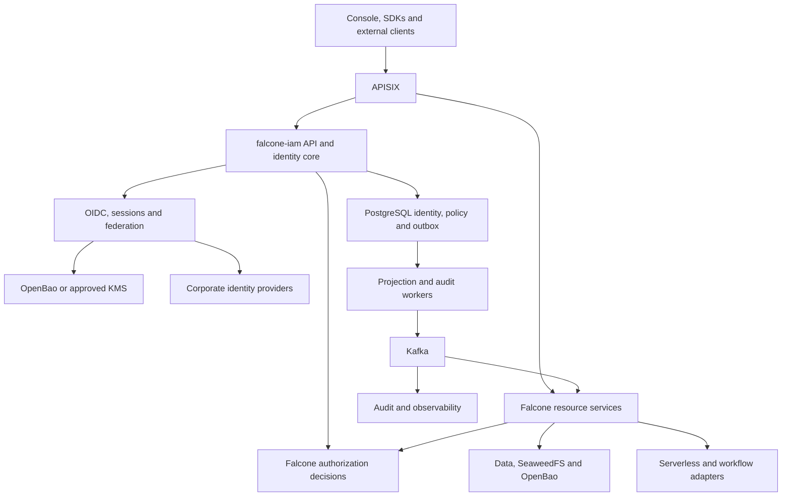
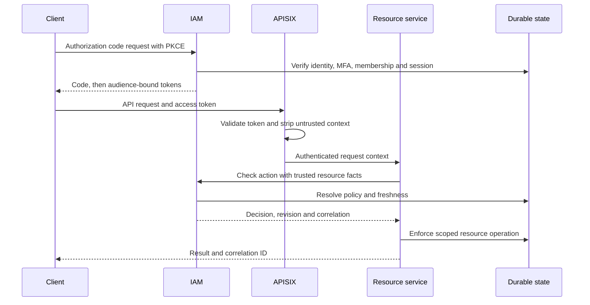

# Baseline architecture

Status: proposed, subject to P0 compatibility and protocol-library qualification. See [decisions](decisions/0001-baseline.md).

## System boundary

`falcone-iam` owns Falcone identity lifecycle, protocol endpoints, sessions, machine credentials and the authorization control plane. It exposes Falcone-native management contracts and standard OIDC/OAuth interfaces. Resource services remain responsible for enforcement and authoritative resource facts.

IAM API/protocol and worker are initially two deployment roles from one modular codebase. Split the decision service or federation adapters only when load, isolation or ownership requires it. No synchronous dependency on a workflow or function engine is allowed in login, refresh, signing or authorization.

## Recommended stack and rationale

| Component | Baseline | Rationale / constraint |
|---|---|---|
| Application core | TypeScript, supported Node.js LTS, modular service | Aligns with the observed Falcone JavaScript contracts and adapters; runtime version pinned during P0 |
| OIDC/OAuth | Qualified `oidc-provider` library; maintained JOSE libraries for consumers | Product code owns persistence, UI and policy while a specialist library handles protocol mechanics. Confirm required extensions and signing adapter; Go/Fosite or Hydra remain evaluated fallbacks |
| Authorization | Falcone's versioned permission catalog and bounded RBAC/attribute rules | Reuse existing semantics. No graph database or general tenant scripting in the baseline |
| Durable storage | Existing PostgreSQL service, dedicated IAM schema/role and migrations | Transactions cover credentials, sessions, grants and outbox; scoped constraints provide defense in depth. Do not reuse an unrestricted control-plane database credential |
| Keys and recoverable secrets | Existing OpenBao or approved KMS with encrypted envelope/signing adapter | Reuse the platform trust custodian. Remote signing compatibility and throughput must be proven; encrypted private keys in memory are an explicit alternative, not non-exportable keys |
| Events | PostgreSQL transactional outbox to existing Kafka | No dual-write gap; at-least-once delivery, versioned projections and reconciliation |
| Cache | Bounded in-process caches first; optional shared cache after benchmark | Cache is never the sole owner of sessions or revocation state. Adding Redis is optional and requires failure semantics |
| Edge | Existing APISIX with allowlisted issuers and authenticated downstream context | Preserve the Falcone gateway and public routing; reject client-supplied identity headers |
| Deployment | OCI images, Helm/Kustomize or existing Falcone packaging, namespaced Deployments/Jobs | Restricted OpenShift compatibility; no custom operator, CRD, host mount or privileged runtime |
| Telemetry | Falcone logging conventions, OpenTelemetry, Prometheus-compatible metrics | Correlate decisions and execution without logging credentials or high-cardinality personal labels |
| UI / SDK | Existing Falcone consoles and SDKs; TypeScript and Go examples | No second disconnected tenant-admin UI; future BFF session handling is a deliberate migration |

## Authority and data model

| Object | Authoritative owner | Consumer behavior |
|---|---|---|
| Principal, external subject link, credentials and sessions | IAM after cutover | Immutable principal ID; external identity key is verified `(issuer, subject)` |
| Tenant/workspace resource existence and resource ownership | Existing Falcone control/resource services | IAM consumes verified references and lifecycle events; never trusts a client-supplied owner attribute |
| Memberships, role bindings and custom grants | Existing Falcone source until migration; IAM after explicit single-writer handoff | Preserve catalog and contract; no bidirectional last-writer-wins synchronization |
| Built-in permissions and semantics | Falcone versioned internal contracts, released with IAM | A resource/action change is a contract change with migration tests |
| Plans, quotas, limits and accounting | Falcone plan/quota services | IAM checks entitlements and emits usage; a paid plan never grants a missing permission |
| Database role, Kafka ACL, S3 identity and secret policy | Backend enforcement systems, projected from authorized Falcone intent | Adapter reports requested and applied revision; reconciliation repairs drift |
| Signing material / recoverable secret bytes | OpenBao/KMS custody, IAM lifecycle policy | Only dedicated components can sign or decrypt; resource runtimes receive scoped credentials |
| Security audit | Durable IAM audit acceptance plus approved Falcone audit store | Tenant admins cannot edit their security trail; access and retention are controlled |

Suggested logical tables: `principals`, `external_identities`, `memberships`, `groups`, `group_memberships`, `role_definitions`, `role_bindings`, `clients`, `consents`, `credentials`, `sessions`, `refresh_families`, `auth_interactions`, `key_metadata`, `policy_revisions`, `outbox`, `projection_state`, `audit_events`, `migration_mappings`. Names are proposals, not committed database compatibility promises. Groups, if enabled, use explicit membership and bounded hierarchy; prevent cycles and privilege escalation.

Tenant-owned entities include `tenant_id`; workspace entities include `workspace_id`. Scoped foreign keys and authorization checks prevent an ID from being attached to another tenant. Globally stable principals do not imply global profile visibility: membership grants access to a tenant-scoped view. Platform administrators are distinct from tenant administrators; cross-tenant support actions require explicit permission and audit. There is no undocumented `internal=true` bypass.

Use per-tenant logical issuers and a separate platform issuer to preserve the observed isolation model. This need not require one process/database per tenant. Trusted metadata records map issuer to tenant; never infer authority from an arbitrary URL, Host header or unsigned claim. Actual public issuer URLs and continuity choices are frozen in P0.

## Authorization semantics

An allow requires all applicable checks: authenticated and active principal; valid client/session/credential; matching resource tenant and permitted workspace; role-granted action; requested client scope; resource constraints; valid delegation chain; and current entitlement/quota approval where required. Explicit denies override grants. Missing required context denies. An approved broad administrator grant is still scoped and audited.

Preserve `security_context`, `authorization_decision` and `projection` contracts: actor, tenant/workspace, plan, scopes, effective roles, correlation ID; decision ID, action/resource, effect/reason and matched policies; target and delegation chain. Add revision/freshness metadata through a versioned contract. Keep existing normalized errors, including `cross_tenant_violation`, `workspace_context_required`, `insufficient_scope`, `delegation_violation` and `quota_exceeded`.

Every decision takes trusted resource facts, not caller-supplied authorization evidence. Decisions and caches include tenant, workspace, actor/credential version, action, resource, relevant attributes and policy revision. A minimum revision supports read-after-write; a replica that cannot meet it waits within a bounded deadline or fails safely. Pagination/counts and direct database paths require data filtering, not just a coarse endpoint allow.

## Typical interactive request

The diagram's durable-state actor represents separate IAM and resource stores, not direct IAM ownership of all data. Login/federation UX, consent and MFA happen in controlled interactions. No resource-owner-password OAuth grant is introduced to preserve a convenient login form.

## Asynchronous work and revocation

1. An authenticated Falcone service accepts a function/workflow request after permission and quota checks. It binds the execution ID, actor and target scope.
2. The trusted execution adapter requests a short-lived, audience-specific credential or preserves the already-qualified function invocation envelope. Tenant code receives only the minimum capability; IAM signing keys and human refresh tokens never enter the runtime.
3. Long-running work stores secret references and delegation metadata, then reauthorizes at activity boundaries and credential renewal. A workflow history replay does not replay authentication authority.
4. Role or credential changes commit authoritative state, a new revision, audit acceptance and an outbox event in one database transaction. Kafka delivery is at least once; projection handlers compare versions and are idempotent.
5. Backends apply ACL/credential changes, invalidate caches and suspend affected WebSockets. A revocation status resource distinguishes committed state from per-consumer completion.
6. If propagation fails, expiry and freshness leases bound continued authorization. Already returned data and completed external side effects cannot be revoked retroactively.

## Contracts to design, not silently invent

Existing `/v1` Falcone routes and normalized admin/session schemas are compatibility anchors. Freeze them before implementation. Proposed internal operations include `authorize`, `authorize-batch`, `introspect`, `delegate`, `revoke` and `projection-status`; their exact routes, schema version and authentication belong in OpenAPI/event schemas during P1. Use idempotency keys for retriable mutations, optimistic revisions for concurrent updates, bounded batch sizes and pagination.

Token fields should separate principal, client, tenant, workspace, audience, scopes, session/credential version and delegation. Avoid embedding every workspace or permission in an unbounded JWT. Map legacy claims through explicit adapters during migration; do not silently reinterpret them across issuers.
